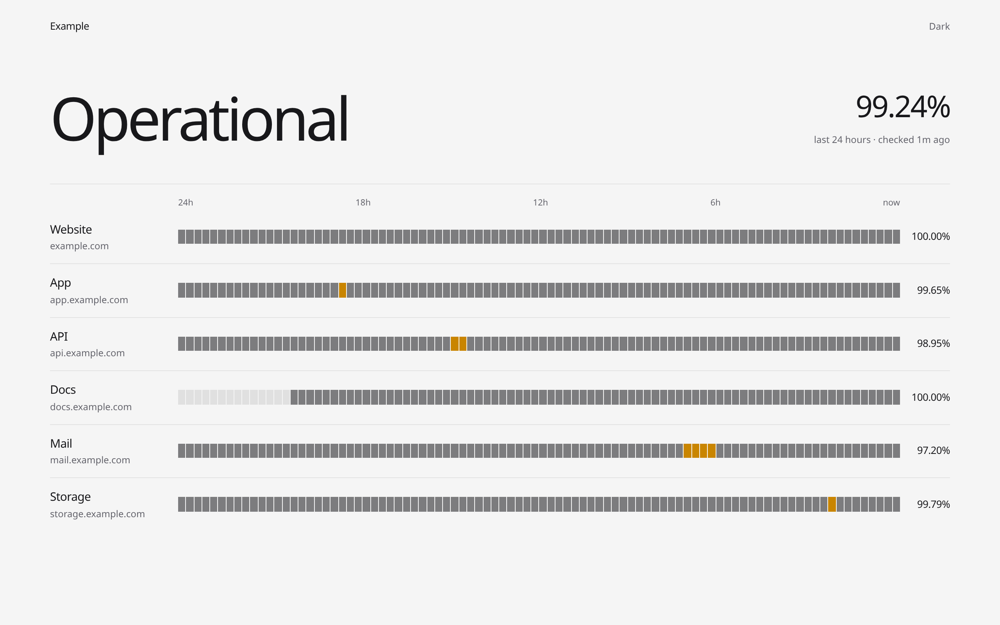
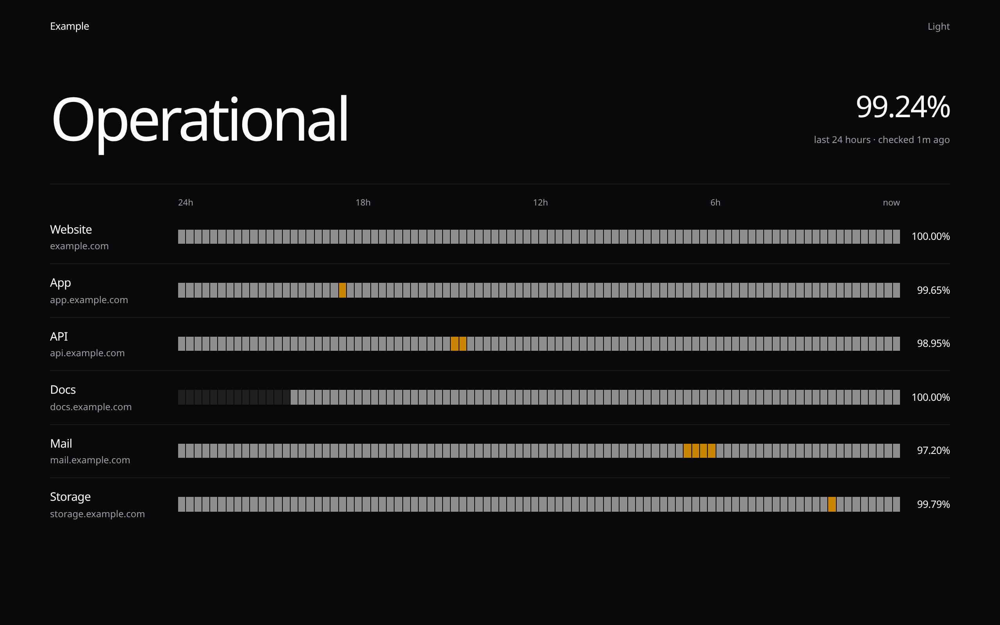

# Modafinil

A self-hosted status page. It checks your URLs once a minute and shows the last 24 hours, updated live.





## Self-hosting

You need Docker with Compose.

```sh
git clone https://github.com/Pollium/Modafinil.git
cd Modafinil
cp .env.example .env
```

Set `POSTGRES_PASSWORD` in `.env`. Then edit `docker-compose.yml`:

- `MONITORS` on the `api` service is the list of things to check, in display order.
- `VITE_STATUS_NAME` on the `web` service is the name shown in the nav and the tab title.

```yaml
MONITORS: >-
  [{"id":"website","name":"Website","url":"https://example.com","blurb":"example.com"},
  {"id":"api","name":"API","url":"https://api.example.com/health","blurb":"api.example.com"}]
```

| Field | |
|---|---|
| `id` | Stable key. Keep it the same to keep the monitor's history. |
| `name` | Shown on the row. |
| `url` | `http://` or `https://`, fetched from inside the api container. |
| `blurb` | Optional line under the name. |
| `anyStatus` | Optional. When `true`, any answer below 500 counts as up. Otherwise only a 2xx counts. |

Start it:

```sh
docker compose up -d --build
```

The page is on http://localhost:8080. Set `MODAFINIL_PORT` in `.env` to use another port.

## Good to know

- After changing `MONITORS`, run `docker compose up -d`. After changing `VITE_STATUS_NAME`, run
  `docker compose up -d --build web`. The name is baked into the page when it is built.
- URLs are fetched from the api container, so `localhost` means the container itself. Self-signed certificates are
  rejected, so those monitors always show as down.
- A check times out after 5 seconds. Set `PROBE_TIMEOUT_MS` on the `api` service to change that.
- Everything is served on one port. If you put it behind your own reverse proxy for TLS, forward websocket upgrades
  too, because the page receives live updates on `/status/live`.
